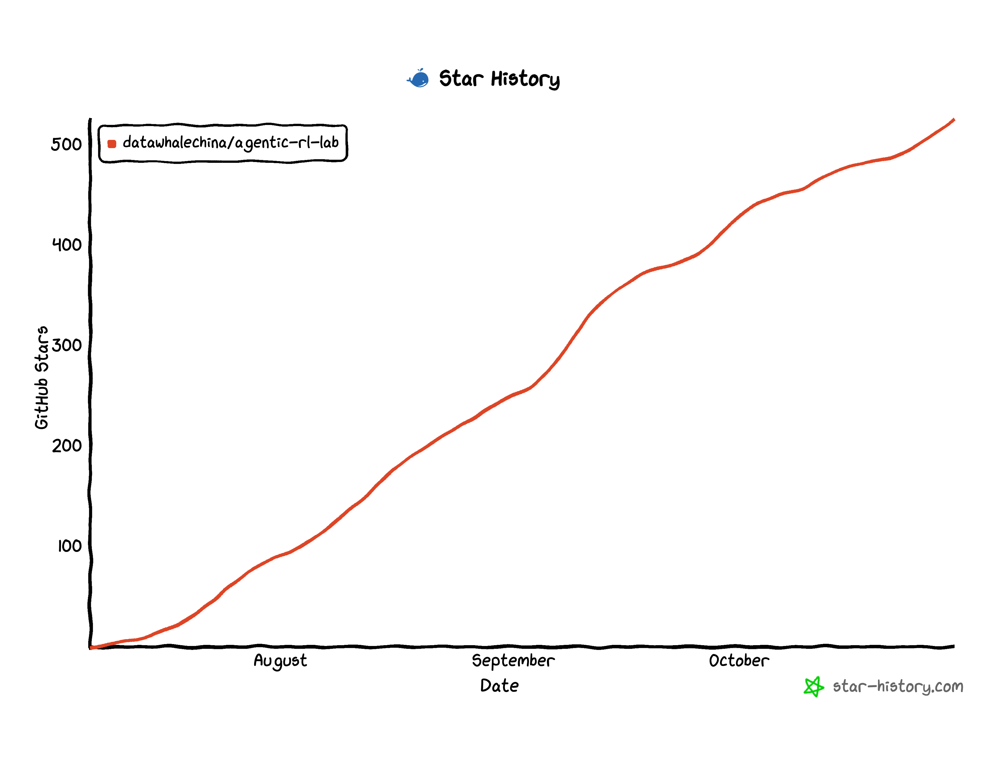

<div align="center">

<a href="https://github.com/datawhalechina/agentic-rl-lab">
  
</a>

<br>

<p>
  <strong>中文</strong> | <a href="./README_EN.md">English</a>
</p>

<p>
  复现和拆解前沿 LLM 强化学习算法，用更简单的代码和更低的 GPU 门槛，把 GRPO、OPD、OPSD、GSPO、DAPO、Search-R1、ReTool、ALFWorld、Vision GRPO、TEMPO、AgentOPSD、Spec-o3、PyTrio-Jev、Slime 等方法跑起来，方便复现。
</p>

<p>
  <a href="https://pytrio.cn/"></a>
  <a href="https://swanlab.cn/"></a>
  <a href="https://www.zhihu.com/people/feng-qi-xia-pian"></a>
  <a href="https://www.xiaohongshu.com/user/profile/63c2055e000000002502c58c"></a>
  <a href="https://github.com/datawhalechina/agentic-rl-lab"></a>
  
</p>

</div>

<p align="center">
  💬 <strong>微信交流群：</strong>
  <a href="https://github.com/datawhalechina/agentic-rl-lab/issues/13">点击查看群二维码</a>
</p>

<p align="center">
  📖 <strong>在线阅读：</strong>
  <a href="https://datawhalechina.github.io/agentic-rl-lab/">中文实验手册</a> ·
  <a href="https://datawhalechina.github.io/agentic-rl-lab/en/">English</a>
</p>

## 项目介绍

&emsp;&emsp;这是一个偏实验记录和教程的仓库。我会用 [PyTRIO](https://pytrio.com) 复现一组和 LLM / Agent RL 相关的强化学习算法，主要做三件事：

1. 先把算法讲明白：它从哪篇论文来，解决什么问题，核心变量是什么。
2. 再用可运行代码复现：数据、reward、loss、训练循环、SwanLab 记录都放在仓库里。
3. 可能未来会做一个更友好和轻量的 Agent RL 和 Harness RL 训练框架～

> *&emsp;&emsp;选择 PyTRIO 的原因很简单，我曾很想要深度研究一下 Agentic-RL 算法，但一直受一些阻力困扰。比如：没卡、训推一体的代码复杂度、Verl 的高耦合工程代码等等。让我一直迟迟没有动手研究。PyTRIO 的出现，让我可以用更简单的代码和更低的门槛来研究 Agentic-RL 算法。仓库的全部内容我仅仅花了不到一个月时间就全部学习和复现完了。*

> *&emsp;&emsp;我认为 PyTrio 或 Tinker 这类产品是面向未来的大模型后训练基础设施，早一点接触对算法工程师或是 Researcher 而言都是很有价值的。*

&emsp;&emsp;如果你有不错的 Agentic-RL idea，想做论文或者做项目，可以写一封邮件来申请 PyTrio 的代金券。审核会比较严格，希望大家在邮件里认真写清楚自己的 proposal。PyTrio 也很乐意赞助大家做 Agentic RL 的项目和论文，邮箱：violin@pytrio.com

## 文章目录

| 主题 | 内容 | 在线版 |
| --- | --- | --- |
| [Loss Function](./experiments/loss-functions/readme.md) | 用直觉解释 `importance_sampling`、`ppo`、`cispo` 分别在优化什么 | [阅读](https://datawhalechina.github.io/agentic-rl-lab/experiments/loss-functions/) |
| [GRPO](./experiments/grpo/readme.md) | 复现 GSM8K 上的 GRPO，并比较 `importance_sampling` / `ppo` / `cispo` 三个 loss | [阅读](https://datawhalechina.github.io/agentic-rl-lab/experiments/grpo/) |
| [Vision GRPO](./experiments/vision-grpo/readme.md) | 在 GeoQA 上接入图片输入，解决几何数学题 | [阅读](https://datawhalechina.github.io/agentic-rl-lab/experiments/vision-grpo/) |
| [PyTrio-Jev](./experiments/pytrio-jev/readme.md) | 一顿麦当劳早餐，人人皆可训练自己的 Jev 决策模型 | [阅读](https://datawhalechina.github.io/agentic-rl-lab/experiments/pytrio-jev/) |
| [General OPD](./experiments/general-opd/readme.md) | 用 DeepMath-103K 跑通 Student 采样、Teacher 打分与 reverse KL 的最小闭环 | [阅读](https://datawhalechina.github.io/agentic-rl-lab/experiments/general-opd/) |
| [Medical OPD](./experiments/medical-opd/readme.md) | 从 Medical SFT 出发，用 SAR-OPD 和 IDT-OPD 增强医疗能力，同时保持通用能力 | [阅读](https://datawhalechina.github.io/agentic-rl-lab/experiments/medical-opd/) |
| [DAPO](./experiments/dapo/readme.md) | 拆解四项核心改进，并记录 Dynamic Sampling 在真实训练中的时间成本 | [阅读](https://datawhalechina.github.io/agentic-rl-lab/experiments/dapo/) |
| [GSPO](./experiments/gspo/readme.md) | 将重要性比率与裁剪从 token 级提升到 sequence 级 | [阅读](https://datawhalechina.github.io/agentic-rl-lab/experiments/gspo/) |
| [OPSD](./experiments/opsd/readme.md) | 用固定的 step-0 Teacher 蒸馏 Student 自采样轨迹 | [阅读](https://datawhalechina.github.io/agentic-rl-lab/experiments/opsd/) |
| [AgentOPSD](./experiments/agentopsd/readme.md) | 用带 Skill 的 Self-Teacher 分配 turn-level credit | [阅读](https://datawhalechina.github.io/agentic-rl-lab/experiments/agentopsd/) |
| [Search-R1](./experiments/search-r1/readme.md) | 用 Qwen3.5-4B、PyTRIO 和可切换的在线搜索后端复现多轮搜索 RL | [阅读](https://datawhalechina.github.io/agentic-rl-lab/experiments/search-r1/) |
| [ReTool](./experiments/retool/readme.md) | 用 Qwen3.5-4B、PyTRIO 和本地代码沙箱复现代码交织的 Agentic RL | [阅读](https://datawhalechina.github.io/agentic-rl-lab/experiments/retool/) |
| [ALFWorld](./experiments/alfworld/readme.md) | 用 12K 长轨迹、真实 TextWorld 环境和 group-relative advantage 训练家务 Agent | [阅读](https://datawhalechina.github.io/agentic-rl-lab/experiments/alfworld/) |
| [TEMPO](./experiments/tempo/readme.md) | 算法级复现 macro-step 优化与生成式 critic | [阅读](https://datawhalechina.github.io/agentic-rl-lab/experiments/tempo/) |
| [Spec-o3](https://github.com/datawhalechina/agentic-rl-lab/blob/main/experiments/spec-o3/readme.md) | 用强化学习找星星：通过 SFT + GRPO，让模型边看光谱、边思考、边调用工具 | [阅读](https://datawhalechina.github.io/agentic-rl-lab/experiments/spec-o3/) |

## 快速启动

&emsp;&emsp;如果是直接 clone 这个仓库：

```bash
git clone https://github.com/datawhalechina/agentic-rl-lab.git
cd agentic-rl-lab
uv sync
```

&emsp;&emsp;运行 Spec-o3 的数据下载、SFT、GRPO、评测和绘图命令，见 [Spec-o3 快速开始](https://github.com/datawhalechina/agentic-rl-lab/blob/main/experiments/spec-o3/start.md)。

&emsp;&emsp;Spec-o3 新增 RL epoch 3 开发集结果：同一批 256 题，Qwen3.5-4B 答对 **175 题（68.36%）**，Qwen3.5-9B 答对 **191 题（74.61%）**，Macro F1 分别为 **70.93% / 75.94%**。完整对照与评测设置见 [Spec-o3 Blog](./experiments/spec-o3/readme.md)。

&emsp;&emsp;运行 ALFWorld、TEMPO 或 AgentOPSD 章节时，需要额外安装 TextWorld 环境依赖：

```bash
uv sync --extra alfworld
```

&emsp;&emsp;如果只想把某个 demo 脚本拎到自己的项目里跑，当前基础依赖为：

```bash
uv add \
  "datasets>=5.0.0" \
  "httpx>=0.28.1" \
  "math-verify>=0.9.0" \
  "matplotlib>=3.11.0" \
  "modelscope>=1.38.1" \
  "numpy>=2.5.1" \
  "openai>=2.44.0" \
  "python-dotenv>=1.2.2" \
  "pytrio==0.2.9" \
  "swanlab==0.9.2" \
  "torch>=2.9.1" \
  "torchvision>=0.27.1" \
  "tqdm>=4.68.3"
```

&emsp;&emsp;Search-R1 直接调用 DeepSeek 官方 Search API，使用 `httpx`，无需额外安装搜索封装。详见[快速启动指南](./experiments/search-r1/start.md)。

&emsp;&emsp;ALFWorld 的 optional extra 对应：

```bash
uv add --optional alfworld "alfworld==0.4.2" "spacy==3.8.13"
```

## 用户故事

&emsp;&emsp;前几天在小红书分享记忆张量（MemTensor）的论文，评论区有位朋友说，他已经入职这家公司，面试时简历里写的就是本仓库的 [AgentOPSD](./experiments/agentopsd/readme.md)！加上好友才发现，刚入门时耐心帮他答疑的 Datawhale 思语，也是我的好朋友。哈哈，世界真小。看来学会 Agentic RL 是真能找到工作啊🤔。目前确实没有其他更好 Agentic RL 教程，Only datawhale can do！

&emsp;&emsp;顺便安利一下他们开源的原生记忆模型 [MemT-1.0](https://github.com/MemTensor/MemT-1.0)，欢迎[下载体验](https://huggingface.co/collections/MemTensor/memt-1)～

## 🙏 致谢

### 核心贡献者

- [宋志学-项目负责人](https://github.com/KMnO4-zx)（Datawhale 成员）

### 贡献者

&emsp;&emsp;想为这个仓库贡献内容？欢迎！请先阅读 [贡献指南](./CONTRIBUTING.md)：新增算法章节请先开 Issue 提案，修复和文档改进可以直接提 PR。

### 特别感谢

- 感谢 [@Sm1les](https://github.com/Sm1les) 对本项目的帮助与支持
- 感谢 [PyTRIO 官方团队](https://pytrio.com) 对本项目的支持
- 感谢 [Kimi 全球大使计划](https://www.kimi.com/zh-cn/lp/kimi-ambassador) 对项目作者的支持
- 感谢 [OpenAI Codex for Open Source 计划](https://developers.openai.com/community/codex-for-oss) 为项目作者提供的 ChatGPT Pro 订阅支持
- 感谢 [火山 Hero 计划](https://www.volcengine.com/) 对项目作者的支持
- 感谢所有为本项目做出贡献的开发者们 ❤️

<div align=center style="margin-top: 30px;">
  <a href="https://github.com/datawhalechina/agentic-rl-lab/graphs/contributors">
    
  </a>
</div>

## Star History

<div align="center">
  
</div>

## License

See [LICENSE](./LICENSE).
