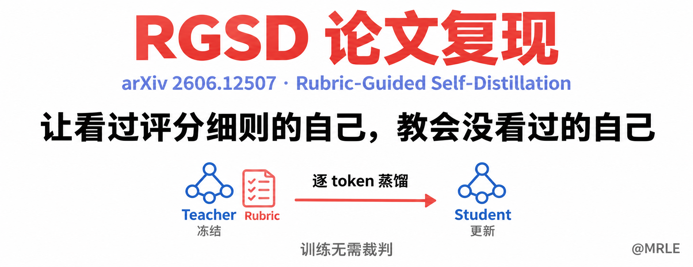
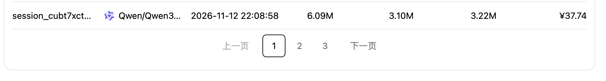
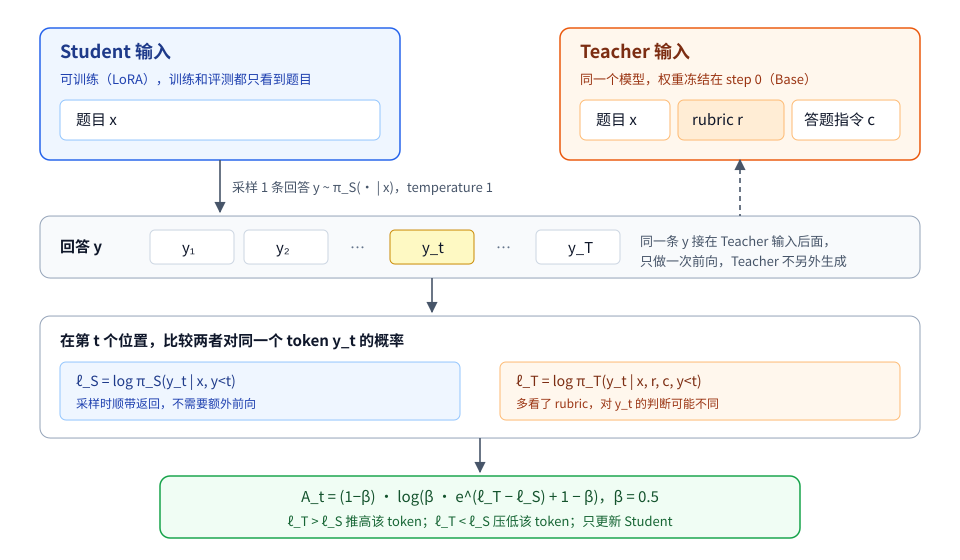

# RGSD 复现：不调用裁判，用评分细则做自蒸馏

> 想跳过正文直接运行？请查看 [快速启动指南](./start.md)：准备数据 → 训练 → 生成 → 打分。

<div align="center">
  
</div>

<div align="center">
  <a href="https://github.com/datawhalechina/agentic-rl-lab/tree/main/experiments/rgsd"></a>
  <a href="https://arxiv.org/abs/2606.12507"></a>
  <a href="https://docs.pytrio.com/docs"></a>
  <a href="https://swanlab.cn/@MRLE/agentic-rl-lab-rgsd/v1/kltrar/runs/iz7ut58e/chart?utm_source=website_qr&utm_medium=qr_scan"></a>
</div>

> **代码与复现资源**
>
> - 本章实现：[训练](https://github.com/datawhalechina/agentic-rl-lab/blob/main/experiments/rgsd/train.py) / [JSD 估计量](https://github.com/datawhalechina/agentic-rl-lab/blob/main/experiments/rgsd/loss.py) / [Student 与 Teacher 模板](https://github.com/datawhalechina/agentic-rl-lab/blob/main/experiments/rgsd/prompts.py) / [评测](https://github.com/datawhalechina/agentic-rl-lab/blob/main/experiments/rgsd/eval.py)
> - 论文：[Rubric-Guided Self-Distillation: Post-Training Without Rubric Verifiers](https://arxiv.org/abs/2606.12507)
> - 数据：[sojuL/RubricHub_v1](https://huggingface.co/datasets/sojuL/RubricHub_v1)
> - SwanLab：[20 步训练记录](https://swanlab.cn/@MRLE/agentic-rl-lab-rgsd/v1/kltrar/runs/iz7ut58e/chart?utm_source=website_qr&utm_medium=qr_scan)
> - 本章作者：[MRLE](https://mrlepro.com)

我第一篇参与贡献的工作 [Tournament-GRPO](../tournament-grpo/readme.md) 把评分细则（rubric）交给裁判，让裁判比较同组回答，再用胜场当 reward。不管逐条打分还是两两比较，训练时都要不停地调用裁判：每一步、每一组回答都要花一次裁判的钱和时间，reward 的质量也取决于裁判靠不靠谱。

RGSD 的思路来自 OPSD：OPSD 里的 Teacher 比 Student 多看到参考解答，RGSD 里 Teacher 多看到的是评分细则（rubric）。

它的做法很像考试前的两种复习状态：同一个学生，拿着评分细则时，更容易知道回答该覆盖哪些要点。RGSD 让「看过细则的自己」当老师，「没看过细则的自己」当学生。Student 先写一条回答，Teacher 再给这条回答的每个 token 计算概率，Student 据此调整自己的偏好。训练全程不调用裁判，评测时才用裁判打分。

本文记录它在 PyTRIO 上的复现：Qwen3.5-4B LoRA，RubricHub 医学子集，20 步。

## 0. 复现结果概览

20 步训练每步 128 道题、每题 1 条回答，共 2,560 条 rollout。KL(S‖m) 从 0.058 降到 0.032，平均回答长度从 918 涨到 1,573 token。在固定的 300 道评测题上，加权 rubric 满足率从 Base 的 36.7 升到 Step 20 的 42.9（+6.3pp）。JSD 采样估计量的梯度用 torch 在随机分布上和精确 JSD 核对过（`loss.py`）。

训练在 PyTRIO 上花了 **37.74 元**，约 2 小时，评测费用没有统计。消费记录如下：



## 1. RGSD 算法

### 1.1 和 GRPO、OPD、OPSD 的关系

| 方法 | 谁给信号 | 信号粒度 | 需要什么 |
| --- | --- | --- | --- |
| GRPO + rubric 裁判 | 外部 LLM 裁判 | 整条回答一个 reward | 每组多条 rollout + 每条都要裁判打分 |
| [OPD](../general-opd/readme.md) | 更大的 Teacher 模型 | 逐 token | 一个更强的模型 |
| [OPSD](../opsd/readme.md) | 看到参考解答的自己 | 逐 token | 每道题的参考解答 |
| **RGSD** | 看到 rubric 的自己 | 逐 token | 每道题的 rubric |

论文对自己的定位是：沿用 On-Policy Distillation 的逐 token 蒸馏和 OPSD 的自蒸馏框架，只把 Teacher 的额外条件换成 rubric。

和 GRPO 相比，它省掉了两样东西。一是裁判：信号来自 Teacher 对 Student 回答的逐 token 概率，一次前向就有，训练中没有任何一条回答被打过分，所以也没有 reward 这个量。二是一组 rollout：信号是逐 token 的，不需要靠组内回答的相对好坏算 advantage，每道题采样 1 条就够。代价是每步多一次 Teacher 前向，而且 Teacher 的输入里多了几十条 rubric，prompt 更长。

论文的主要结论是：在 RubricHub 的医学和科学两个领域，RGSD 的 rubric 满足率能追平用 gpt-4o-mini 当裁判的 GRPO，而每道题只需要一条 rollout，并且回答比 GRPO 更短。

### 1.2 Teacher 和 Student 各看到什么

记题目为 $x$，这道题的 rubric 列表为 $r$，答题指令为 $c$。$c$ 是 Teacher 模板最后要求详尽作答的那句指令（论文称为 transition prompt），见下方模板的最后一段。Student 和 Teacher 是同一个 Qwen3.5-4B，只是条件不同：

```math
\text{Student: } \pi_S(\cdot \mid x,\, y_{<t}) \qquad\qquad \text{Teacher: } \pi_T(\cdot \mid x,\, r,\, c,\, y_{<t}) \qquad\qquad y \sim \pi_S(\cdot \mid x)
```

Student 是可训练的 LoRA，输入只有题目本身，没有 system prompt，也没有附加指令。Teacher 固定为训练开始前的 Base 权重，全程不更新。回答 $y$ 只从 Student 采样。

Teacher 的输入照搬论文附录的模板（`prompts.py`），题目、rubric 和答题指令放在同一条 user 消息里：

```text
<题目>

Hidden evaluation criteria that a good response should satisfy:
1. <rubric 1>
2. <rubric 2>
...

After understanding these evaluation criteria, provide your own thorough response to the problem. Address the criteria naturally without explicitly referencing them.
```



Teacher 在训练中不生成回答，只给 Student 的同一条回答算概率。在第 $t$ 个位置，两者都接着 Student 已生成的前缀 $y_{<t}$，比较同一个 token $y_t$，所以两条 logprob 序列可以逐位置对齐。

### 1.3 论文的训练目标

论文的损失（公式 3）是在 Student 自己采样的回答上，逐位置计算 Student 分布和 Teacher 分布之间的散度，再在回答内部取平均：

```math
\mathcal{L}_{\text{RGSD}}(\theta_S)=\mathbb{E}_{(x,r)\sim\mathcal{D},\;y\sim\pi_S(\cdot\mid x)}\left[\frac{1}{T}\sum_{t=1}^{T}D^{\text{clip}}_{\beta}\Big(\pi_S(\cdot\mid x,y_{<t})\;\Big\|\;\pi_T(\cdot\mid x,r,c,y_{<t})\Big)\right]
```

$D_\beta$ 是广义 JSD。以混合分布 $m$ 为参照，分别算 Teacher 和 Student 到 $m$ 的 KL：

```math
m = \beta\,\pi_T + (1-\beta)\,\pi_S,\qquad
\mathrm{JSD}_\beta = \beta\,\mathrm{KL}(\pi_T \,\|\, m) + (1-\beta)\,\mathrm{KL}(\pi_S \,\|\, m)
```

论文把它描述为介于 forward KL 和 reverse KL 之间的插值，全程取 $\beta=0.5$，此时两项对称。实现细节在附录的超参表里：散度只在 Teacher 概率最高的 128 个词上计算，并带一个 τ=0.05 的裁剪，正文没有给出裁剪的具体形式。

这个目标里的 $\sum$ 是对词表求和的。每个位置上，Student 的整个分布都被拉向 $m$，不只是被采样到的那个 token。我们的 PyTRIO 版本和论文最大的区别就在这里，见第 3 节和 1.6 的例子。

### 1.4 一步训练做了什么

论文的 Algorithm 1 很短。下面按 `train.py` 的实际做法展开，标出每个量的形状；$T_i$ 是第 $i$ 条回答的 token 数：

```text
输入：Base 权重 θ₀，数据 D = {(x, r)}，β = 0.5，每步 B = 128 道题
θ_S ← θ₀（LoRA 初始化为 0）；θ_T ← θ₀，冻结

for step = 1 … N:
    取 B 道题 {(x_i, r_i)}
    对每道题 i（并发）：
        y_i ~ π_S(· | x_i)                        # 采样 1 条回答，顺带得到 ℓ_S ∈ R^{T_i}
        ℓ_T = log π_T(y_i | x_i, r_i, c)           # Teacher 对同一条 y_i 前向一次，ℓ_T ∈ R^{T_i}
        A_i = (1-β)·log(β·exp(ℓ_T - ℓ_S) + 1-β)    # 逐 token advantage，R^{T_i}（第 3 节）
        A_i ← A_i / T_i                           # 回答内部取平均，对应公式里的 1/T
    一次 forward_backward（importance_sampling 损失）+ 一次 Adam 更新 θ_S
```

论文在最后一步直接对 $\mathcal{L}_\text{RGSD}$ 求梯度。我们拿不到 Teacher 的完整分布，所以先把散度换成逐 token 的 $A$，再交给 PyTRIO 的 `importance_sampling` 损失。`train.py` 在更新前还会检查采样端和训练端的 logprob 是否一致、用固定探针确认参数确实在变，并把整批 advantage 乘一个公共系数（4.2）。

### 1.5 几个设计选择

论文没有逐条解释下面这些选择，以下是我们结合 OPD 和 OPSD 的理解。

回答从 Student 自己采样（on-policy）。Teacher 纠正的是 Student 评测时真正会写出来的前缀。如果反过来让 Teacher 生成回答、Student 去模仿，Student 学到的是 Teacher 的前缀，评测时自己一旦写偏，就落到没见过的状态里，这是模仿学习里的 exposure bias。论文在相关工作中把这类做法和 DAgger 联系起来：让学生自己走，在学生到达的状态上问专家。

Teacher 冻结在 step 0。Teacher 和 Student 是同一个模型，如果 Teacher 跟着更新，Student 的变化会反过来改变训练目标。冻结之后，目标始终是「Base 在看到 rubric 时会怎么写」。论文提到另一项工作让 Teacher 一起训练，RGSD 没有这样做。

用 JSD 而不是 reverse KL。OPSD 用的 reverse KL 在 Teacher 认为某个 token 几乎不可能时，惩罚会无限放大。JSD 以混合分布 $m$ 为参照，$m$ 里至少有 $(1-\beta)$ 份 Student 自己的分布，所以散度有上界。

每题一条 rollout。论文强调 RGSD 的信号是稠密的，回答里每个 token 都贡献一项散度，而 GRPO 是整条回答结束后一个标量。稠密信号不依赖组内比较，一条回答就能算。

### 1.6 一个真实的例子

下面用一条真实的训练数据看看 Teacher 的信号长什么样。题目是训练集的 `medical-004957`：

```text
Doctor, I have been experiencing a high-grade fever for the past day along with bone pain and fatigue. Should I be concerned?
```

这道题有 26 条 rubric，其中几条：回答应分节、用标题组织（#14）；结尾给出简短总结（#15）；指出高烧加剧烈骨痛可能是登革热（#21）；必须出现 "breakbone fever" 这个说法（#24）。

Student 在 step 1 写的回答（452 token）先给免责声明，再列可能原因：骨髓炎、深部感染、败血症、恶性肿瘤、自身免疫病，最后建议立即就医，全文没有提登革热。step 1 的 Student 就是 Base（LoRA 初始为 0），所以我们用 Base 分别以 Student 和 Teacher 的输入对这条回答算了一遍逐 token logprob，又取了几个位置上 Teacher 的 top-8 候选。这条回答里 Teacher 更认可的 token 占 29%，和训练日志里记录的一致。挑几个位置：

| 前文 → 采样到的 token | $\ell_S$ | $\ell_T$ | $A_t$ | Teacher 最想写的 |
| --- | ---: | ---: | ---: | --- |
| `**` → `Important` | −3.43 | −0.31 | +1.23 | `Important`（73%） |
| `…immediately.**⏎⏎` → `Regarding` | −2.68 | −8.08 | −0.34 | `###`（91%） |
| `the addition of` → ` severe` | −4.39 | −0.88 | +1.42 | ` severe`（41%） |
| `need to be ruled out, such as` → `:` | −0.00 | −6.60 | −0.35 | ` Deng` / ` **`（各约 33%） |
| `such as:⏎*   **` → `Bone` | −2.92 | −8.45 | −0.35 | `D`（82%） |
| `Please go to an **` → `urgent` | −2.49 | −0.26 | +0.82 | `urgent`（77%） |
| `critical for outcomes.` → `<\|im_end\|>` | −0.04 | −8.13 | −0.35 | `⏎⏎`（99%） |

看了 rubric 的 Teacher，想法和 Student 很不一样。Student 列原因时从 "Bone"（骨髓炎）开始，Teacher 想写的是 "D"，接下来大概率是 Dengue；Student 写正文时直接用 "Regarding" 开段，Teacher 想先写一个 `###` 标题；Student 写完建议就结束，Teacher 给结束符的概率只有 $e^{-8.1}$，它还想继续写，对应 rubric 里的结尾总结和邀请补充信息。

这张表也能看出第 3 节估计量的两个性质。第一，负向 advantage 都贴着下界 −0.35，正向可以到 +1.42：Teacher 不认可时，一个 token 最多被压这么多，认可时没有同样的上限。第二，信号只落在被采样到的 token 上。在 "Bone" 处，Student 会被压低 "Bone"，但 Teacher 最想写的 "D" 不会被直接推高，被压掉的概率会按 Student 原有的比例分给其他候选。论文在 top-128 词表上算精确 JSD，会直接把 "D" 往上拉。

最后一行还有一个值得追的现象：如果大多数回答在结尾都收到「不要停」的负向信号，就可能和 6.1 里回答越来越长有关。这里只看了一条回答，要下结论还得统计更多回答结尾的 $A_t$。

## 2. 为什么「看过 rubric 的自己」能当老师

论文在训练前先做了一个诊断（Table 1）：同一个模型，只看题目和看题目 + rubric，回答的 rubric 满足率差多少。差距非常大，Qwen3-4B-Thinking 在医学上从 43.6 涨到 89.8。我们用 Qwen3.5-4B 在评测集前 100 题上也测了一遍：

| 条件 | 满足率 | 平均回答 token |
| --- | ---: | ---: |
| 只看题目（Student 的输入） | 46.9 | 851 |
| 题目 + rubric（Teacher 的输入） | 94.1 | 1,326 |

这说明 rubric 里有大量 Student 没用上的信息。RGSD 的假设是：这些信息里有一部分不是这道题独有的，而是「一个好的医学回答通常该覆盖什么」，比如该问的鉴别诊断、该提醒的就医时机、该写的禁忌。如果 Student 在很多道题上反复向「看过细则的自己」靠拢，也许能把这些习惯学进权重里，评测时不看 rubric 也能写出来。

## 3. PyTRIO 上的实现：只用采样到的 token

论文在 Teacher 的 top-128 词表上精确计算 JSD。PyTRIO 0.2.9 只能拿到 top-20 的 logprob，训练端的 `target_tokens` 也只能是一维，没法对整个词表求和。所以我们换了个办法：只用 Student 实际采样到的那个 token。

把 JSD 对 Student 参数求导，Teacher 那一项的梯度会被抵消，剩下的形式和策略梯度一样：

```math
\nabla_\theta \mathrm{JSD}_\beta = -\,\mathbb{E}_{y\sim\pi_S}\big[A(y)\,\nabla_\theta \log \pi_S(y)\big],\qquad A(y) = (1-\beta)\log\frac{m(y)}{\pi_S(y)}
```

也就是说，把 $A$ 当成 advantage，按 Student 自己的分布采样一个 token，就能得到 JSD 梯度的无偏估计。PyTRIO 的 `importance_sampling` 损失正好接收逐 token 的 advantage。把 $m=\beta\pi_T+(1-\beta)\pi_S$ 代进去，只剩两个 logprob（记号同 1.2 的图）：

```math
A_t = (1-\beta)\,\log\!\big(\beta\,e^{\ell_T-\ell_S} + 1-\beta\big)
```

Teacher 比 Student 更认可这个 token（$\ell_T>\ell_S$）时 $A_t>0$，往上推；更不认可时 $A_t<0$，往下压，最低到 $(1-\beta)\log(1-\beta)\approx-0.35$；两者一致时 $A_t=0$。正向则没有上限，会随 $\ell_T-\ell_S$ 增大而增大，1.6 的例子里最大到 +1.42。

<details>
<summary>为什么 Teacher 那一项会抵消</summary>

$\pi_T$ 不依赖 $\theta$，但 $m$ 里含有 $(1-\beta)\pi_S$，所以 $\beta\,\mathrm{KL}(\pi_T\|m)$ 也有梯度，等于 $-\beta(1-\beta)\sum_v \frac{\pi_T(v)}{m(v)}\nabla_\theta\pi_S(v)$。$(1-\beta)\,\mathrm{KL}(\pi_S\|m)$ 求导后，除了 $(1-\beta)\sum_v \nabla_\theta\pi_S(v)\log\frac{\pi_S(v)}{m(v)}$，还多出 $(1-\beta)\sum_v \nabla_\theta\pi_S(v)\big(1-\frac{(1-\beta)\pi_S(v)}{m(v)}\big)$。把两个多出来的部分相加，括号里变成 $1-\frac{m(v)}{m(v)}=0$。最后用 $\nabla_\theta\pi_S=\pi_S\nabla_\theta\log\pi_S$ 把对词表的求和写成按 $\pi_S$ 采样的期望。

直接运行 `uv run python experiments/rgsd/loss.py`，会在随机分布上用 torch 数值核对这个结果。

</details>

代价是方差更大，而且只能调整采样到的 token（1.6 里的 "Bone" 和 "D"）。估计要求按 Student 自身的分布采样，所以训练固定 temperature=1、top_p=1、top_k=-1；回答仍有 2048 token 的长度上限。

| 符号 | 含义 | 本章取值 |
| --- | --- | --- |
| $\beta$ | JSD 的混合系数 | 0.5（同论文） |
| batch | 每步题目数，每题 1 条 rollout | 128（同论文） |
| max tokens | Student 回答上限 | 2048 |
| lr | LoRA rank 64 的学习率，10% warmup 后恒定 | 4e-5 |
| 训练日志里的 `KL(S‖m)` | 采样 token 上 $\log\pi_S - \log m$ 的均值 | 越小说明 Student 越接近混合分布 |

## 4. 我们是怎么复现的？

### 4.1 数据

RubricHub 公开版没有官方的 train/val 划分，行数也和论文不同。`prepare_data.py` 固定数据 revision，按 seed 42 打乱，每个领域切出 300 题当评测集，其余当训练集。医学训练集 29,381 题，平均每题 30 条 rubric，权重 2–15。

评测分数是论文公式 1 的加权满足率：裁判逐条判断 rubric 是否满足，满足条目的权重之和除以全部权重之和。

### 4.2 Advantage 如何进入更新

代码先把每条回答的 $A_t$ 除以自身的训练 token 数 $T_i$，让长短回答按序列平均；提交给 `importance_sampling` 前，再乘 batch 的平均训练长度 $\bar T$（`train.py` 的 `batch_scale`）：

```math
\widetilde A_{i,t}=\frac{\bar T}{T_i}A_{i,t},\qquad
\bar T=\frac{1}{B}\sum_{i=1}^{B}T_i
```

同一 batch 内，各条回答的相对权重仍按 $1/T_i$ 缩放，公共系数 $\bar T$ 只用来调整梯度量级。这是我们为 LoRA 加的缩放，论文没有这一步。

阶段 A 的梯度范数约为 0.013–0.035。脚本用 `--min-grad-norm`（默认 1e-3）排查异常小的梯度，再用固定探针的 logprob 变化确认模型输出确实发生了变化。

### 4.3 与论文的差异

| 项目 | 论文 | 本章 | 影响 |
| --- | --- | --- | --- |
| 基座模型 | Qwen2.5-3B/7B-Instruct、Qwen3-4B/8B-Thinking | Qwen3.5-4B，关闭思考 | 绝对分数不能和论文直接对比 |
| 参数更新 | 全参，lr 4.2e-6 | LoRA rank 64，lr 4e-5 | 没有扫参 |
| 损失 | Teacher top-128 词表上的精确 JSD，裁剪 τ=0.05 | 采样 token 的无偏梯度估计，不裁剪 | 梯度方差更大，Teacher 偏好的未采样 token 不会被直接推高 |
| 训练量 | 5 epoch，医学 490 步 | 20 步 | 只够看早期变化 |
| 数据划分 | RubricHub 官方 train / val | 公开 parquet 按 seed 自行切分 | 评测集不同 |
| 回答上限 | 2048（Instruct）/ 4096（Thinking） | 2048 | 训练后期约 20% 被截断，见 6.1 |
| 评测裁判 | gpt-5.4 | gpt-6.1 | 分数尺度不同 |

β=0.5、batch 128、每题 1 条 rollout、10% warmup 后恒定学习率、Teacher 固定在 step 0、Student 与 Teacher 的模板都和论文保持一致。

## 5. 训练中最应该看哪些指标？

| 指标 | 看什么 |
| --- | --- |
| `rgsd/kl_student_mixture` | Student 离混合分布有多远，应该下降 |
| `rgsd/teacher_prefers_rate` | Teacher 比 Student 更认可的 token 占比 |
| `optim/grad_norm` | 低于 1e-3 时触发本次配置的停止阈值；结合固定探针判断更新情况（4.2） |
| `consistency/*` | 采样端与训练端 logprob 差，正常约 0.01–0.04 |
| `probe/*` | 探针序列的 logprob 变化，确认参数在动 |
| 回答长度与截断率 | 截断的回答没有结尾，Student 学不到「什么时候该停」 |

KL 下降只说明 Student 和 Teacher 越来越像，不说明回答变好，效果要看独立评测。

## 6. 实验结果

### 6.1 20-step 训练

配置：Qwen3.5-4B，LoRA rank 64，lr 4e-5（第 1 步 warmup 为 2e-5），每步 128 题，回答上限 2048 token，共 20 步，每 10 步保存。


| 指标 | Step 1 | Step 10 | Step 20 |
| --- | ---: | ---: | ---: |
| KL(S‖m)（按 token 加权） | 0.0583 | 0.0308 | 0.0321 |
| 平均回答 token | 918 | 1,116 | 1,573 |
| 截断率 | 1.6% | 9.4% | 21.1% |
| Teacher 更认可的 token 占比 | 33.2% | 52.9% | 46.5% |

20 步可以分成两段。前 10 步 KL 从 0.058 降到 0.031，Teacher 更认可的 token 从 33% 升到 53%，回答长度变化不大，Student 在向 Teacher 靠拢。后 10 步 KL 停在 0.030 左右不再下降，Teacher 更认可的比例反而回落到 46%，回答长度从 1,116 涨到 1,573，截断率从 9% 涨到 21%，这一段变化最大的是长度。

### 6.2 Eval

在固定的 300 题评测集上，每个模型每题生成 1 条回答（temperature 1、top_p 1），关闭思考，上限 2048 token，然后用同一个裁判逐条判断 rubric。

除了 Base 和两个 checkpoint，我们加了一个论文里没有的对照：Base + thorough，在题目后面空一行，加上 Teacher 模板里与 rubric 无关的那句话：

```text
Provide a thorough response to the problem.
```

加它的原因是 6.1 里回答越来越长。Teacher 的答题指令 $c$ 本身就要求 thorough，Student 向 Teacher 靠拢时，可能学到的只是「写全一点」，而不是 rubric 的内容。这个对照不训练，只改提示词，用来回答：一句话能拿到多少分？


| 模型 | 满足率 | 平均回答 token | 截断率 |
| --- | ---: | ---: | ---: |
| Base | 36.7 | 873 | 0.3% |
| Base + thorough | 43.8 | 1,372 | 4.7% |
| RGSD Step 10 | 31.5 | 1,182 | 12.0% |
| RGSD Step 20 | 42.9 | 1,617 | 25.3% |
| RGSD Step 20（上限 4096） | 43.3 | 1,803 | 4.7% |

只有 300 道题，换一批题分数就会上下浮动几个点。为了判断两个模型的差距是不是偶然，我们在同一道题上算两者的得分差，再对 300 道题做 bootstrap，得到差值的 95% 区间。区间不包含 0，才说明差距显著。图中的误差线是各模型自身分数的 95% 区间。

Step 10 比 Base 低 5.2pp（区间 −6.7～−3.7），下降主要在事实类和安全提醒类的 rubric 条目，评测回答里有 23 条陷入重复。这一步 KL 刚降下来，回答还没变长，质量却先变差了。

Step 20 比 Base 高 6.3pp（区间 +4.7～+7.8），量级和论文 Qwen3-4B-Thinking 在 RubricHub 医学上的 +7.5pp 接近。但只多一句话、没有训练的 Base + thorough 比 Base 高 7.2pp（区间 +5.8～+8.7）。Step 20 比 Base + thorough 低 0.9pp，区间 −2.4～+0.5 包含 0，两者算打平。

把上限放到 4096 不改变结论：截断率从 25% 降到 5%，分数只多 0.3pp。被 2048 截断的题本身就更难，放开上限后也只从 35.3 涨到 36.7。

## 7. 这次复现有哪些边界？

代码链路是通的：JSD 估计量的梯度经过数值核对，20 步里 Student 稳定地向 Teacher 靠拢（KL 下降、Teacher 认可率上升），评测分数在 Step 20 显著高于 Base，量级和论文一致。

但这些结果不能说明「RGSD 让模型学到了 rubric 的内容」。在我们的设置下，Step 20 的涨幅可以被一句 thorough 提示完全复现。另外，模型、全参还是 LoRA、损失的估计方式、数据划分和裁判都与论文不同，绝对分数不能和论文对比。

## 8. 待验证的问题

以下几点来自复现观察，尚未进一步实验验证。

Student 学到的是 rubric，还是「写全一点」？最直接的消融是 Teacher 不给 rubric、只保留同样的答题指令 $c$，其余设置完全相同再训练 20 步。阶段 A 减去这个对照，才是 rubric 本身的贡献。更便宜的检查是给 Step 20 也加上 thorough 指令评测：如果它明显高于 Base + thorough，说明训练学到的东西和「写全」可以叠加。

训练更久会不会不一样？KL 在第 10 步之后不再下降，后 10 步主要是长度在涨。不确定这是 LoRA、学习率还是采样估计的方差造成的平台，还是 20 步之后会继续下降。需要续训到更多步数，并且每个 checkpoint 都和 Base + thorough 比较。

截断对蒸馏有什么影响？RGSD 是逐 token 蒸馏，截断不像 GRPO 那样让 reward 失真，被截断的回答前面的 token 照样有信号。但截断回答里没有结束符，Student 学不到「什么时候该停」，这可能和长度持续增长有关。

## 9. 小结

RGSD 把 rubric 从裁判手里拿回来，交给模型自己：看过 rubric 的自己当老师，没看过的自己当学生，逐 token 用 JSD 蒸馏。训练不需要裁判，每道题只要一条 rollout，代价是 Teacher 每步要多做一次带 rubric 的前向。

## 参考资料

1. MohammadHossein Rezaei et al. [Rubric-Guided Self-Distillation: Post-Training Without Rubric Verifiers](https://arxiv.org/abs/2606.12507), 2026.
2. [sojuL/RubricHub_v1](https://huggingface.co/datasets/sojuL/RubricHub_v1)
3. [Qwen/Qwen3.5-4B](https://huggingface.co/Qwen/Qwen3.5-4B)
4. [PyTRIO 文档](https://docs.pytrio.com/docs)
5. [SwanLab 文档](https://docs.swanlab.cn/)
