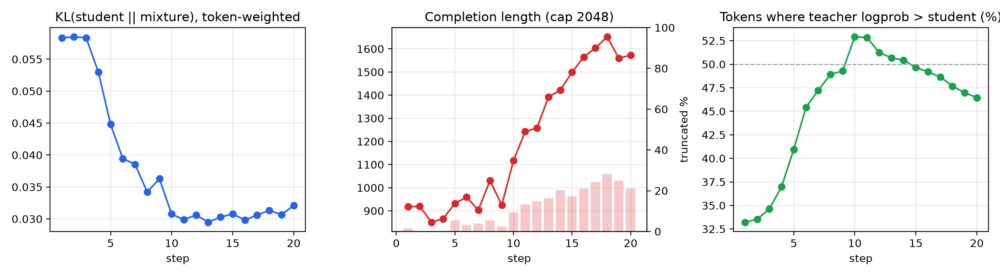
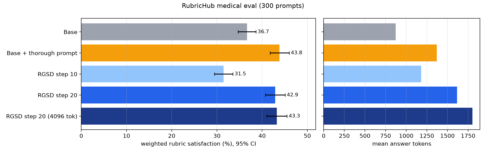

# RGSD 复现：不调用裁判，用评分细则做自蒸馏

> 想跳过正文直接运行？请查看 [快速启动指南](./start.md)：准备数据 → 训练 → 生成 → 打分。

<div align="center">
  
</div>

<div align="center">
  <a href="https://github.com/datawhalechina/agentic-rl-lab/tree/main/experiments/rgsd"></a>
  <a href="https://arxiv.org/abs/2606.12507"></a>
  <a href="https://docs.pytrio.com/docs"></a>
  <a href="https://swanlab.cn/@MRLE/agentic-rl-lab-rgsd/v1/kltrar/runs/iz7ut58e/chart?utm_source=website_qr&utm_medium=qr_scan"></a>
</div>

> **代码与复现资源**
>
> - 本章实现：[训练](https://github.com/datawhalechina/agentic-rl-lab/blob/main/experiments/rgsd/train.py) / [JSD 估计量](https://github.com/datawhalechina/agentic-rl-lab/blob/main/experiments/rgsd/loss.py) / [Student 与 Teacher 模板](https://github.com/datawhalechina/agentic-rl-lab/blob/main/experiments/rgsd/prompts.py) / [评测](https://github.com/datawhalechina/agentic-rl-lab/blob/main/experiments/rgsd/eval.py)
> - 论文：[Rubric-Guided Self-Distillation: Post-Training Without Rubric Verifiers](https://arxiv.org/abs/2606.12507)（
> - 数据：[sojuL/RubricHub_v1](https://huggingface.co/datasets/sojuL/RubricHub_v1)
> - SwanLab：[训练记录](https://swanlab.cn/@MRLE/agentic-rl-lab-rgsd/v1/kltrar/runs/iz7ut58e/chart?utm_source=website_qr&utm_medium=qr_scan) 20-step 训练记录
> - 本章作者：[MRLE](https://mrlepro.com)

我第一篇参与贡献的工作 [Tournament-GRPO](../tournament-grpo/readme.md) 把评分细则（rubric）交给裁判，让裁判比较同组回答，再用胜场当 reward。不管逐条打分还是两两比较，训练时都要不停地调用裁判：每一步、每一组回答都要花一次裁判的钱和时间，reward 的质量也取决于裁判靠不靠谱。

RGSD 的问题是：rubric 已经写好了，能不能**不要裁判**，直接让模型从 rubric 里学？

它的做法很像考试前的两种复习状态：同一个学生，拿着评分细则时，更容易知道回答该覆盖哪些要点。RGSD 让「看过细则的自己」当老师，「没看过细则的自己」当学生。Student 先写一条回答，Teacher 再给这条回答的每个 token 计算概率，Student 据此调整自己的偏好。训练全程不调用裁判，评测时才用裁判打分。

本文记录它在 PyTRIO 上的复现：Qwen3.5-4B LoRA，RubricHub 医学子集，20 步。结论先说在前面：20 步之后的分数涨幅和论文同一量级，但我们加了一个论文里没有的对照，发现**只给 Base 加一句「请详细回答」就能拿到同样的分数**。所以这 20 步到底学到了 rubric 的内容，还是只学会了「写长一点、写全一点」，目前还没有答案。

## 0. 复现结果概览

| 项目 | 状态 |
| --- | --- |
| JSD 采样估计量 | 用 torch 在随机分布上核对与精确 JSD 的梯度一致（`loss.py`） |
| 20-step 训练（每步 128 题 × 1 条 rollout） | 2,560 条 rollout，KL(S‖m) 0.058 → 0.032，平均长度 918 → 1,573 token |
| Base vs checkpoint 评测 | 固定 300 题，加权 rubric 满足率 36.7 → 42.9（+6.3pp） |
| 提示词对照 | Base 加一句 thorough 指令为 43.8；Step 20 与它相比 −0.9pp，不显著 |
| 费用与耗时 | 训练 37.74 元（PyTRIO，约 2 小时）；评测费用未统计 |

本次 20-step 训练的 PyTRIO 消费记录如下，费用为 **37.74 元**。


## 1. 训练流程

把 RGSD 和前面几章放在一起看会清楚一些：

| 方法 | 谁给信号 | 信号粒度 | 需要什么 |
| --- | --- | --- | --- |
| GRPO + rubric 裁判 | 外部 LLM 裁判 | 整条回答一个 reward | 每组多条 rollout + 每条都要裁判打分 |
| [OPD](../general-opd/readme.md) | 更大的 Teacher 模型 | 逐 token | 一个更强的模型 |
| [OPSD](../opsd/readme.md) | 看到参考解答的自己 | 逐 token | 每道题的参考解答 |
| **RGSD** | 看到 rubric 的自己 | 逐 token | 每道题的 rubric |

RGSD 沿用了 OPSD 的特权上下文思路：把 Teacher 看到的「参考解答」换成「rubric」，再用 JSD 构造逐 token 的蒸馏信号：

```math
\text{Question} \rightarrow \text{Student 采样} \rightarrow \text{Teacher(Question + Rubric) 逐 token 打分} \rightarrow \text{JSD advantage} \rightarrow \text{Student 更新}
```

和 GRPO 相比，它省掉了两样东西：

- **不需要裁判**。信号来自 Teacher 对 Student 回答的逐 token 概率，一次前向就有。
- **不需要一组 rollout**。每道题只采样 1 条回答，不用靠组内比较算 advantage。

**Teacher 在训练中只给 Student 的同一条回答算概率，不另外生成答案。** 在第 $t$ 个位置，两者都接着 Student 已生成的前缀 $y_{<t}$，比较同一个 token $y_t$：Student 只以问题为条件，Teacher 的条件里多了 rubric。这样得到的两个 logprob 才能逐位置对齐。

论文的主要结论是：在 RubricHub 的医学和科学两个领域，RGSD 的 rubric 满足率能追平用 gpt-4o-mini 当裁判的 GRPO，而每道题只需要一条 rollout，并且回答比 GRPO 更短。

## 2. 为什么「看过 rubric 的自己」能当老师

论文在训练前先做了一个诊断（Table 1）：同一个模型，只看题目和看题目 + rubric，回答的 rubric 满足率差多少。差距非常大，Qwen3-4B-Thinking 在医学上从 43.6 涨到 89.8。我们用 Qwen3.5-4B 在评测集前 100 题上也测了一遍（1 题裁判失败，剩 99 题）：

| 条件 | 满足率 | 平均回答 token |
| --- | ---: | ---: |
| 只看题目（Student 的输入） | 46.9 | 851 |
| 题目 + rubric（Teacher 的输入） | 94.1 | 1,326 |


这说明 rubric 里有大量 Student 没用上的信息。RGSD 的假设是：这些信息里有一部分不是这道题独有的，而是「一个好的医学回答通常该覆盖什么」，比如该问的鉴别诊断、该提醒的就医时机、该写的禁忌。如果 Student 在很多道题上反复向「看过细则的自己」靠拢，也许能把这些习惯学进权重里，评测时不看 rubric 也能写出来。

需要注意的是，Teacher 看到的是**这道题**的 rubric，Student 在评测时永远看不到。94 分是 Teacher 抄着答案要点写出来的，不是 Student 能达到的上限。

## 3. 核心变量和公式

Teacher 的输入照搬论文附录的模板（`prompts.py`）：

```text
<题目>

Hidden evaluation criteria that a good response should satisfy:
1. <rubric 1>
2. <rubric 2>
...

After understanding these evaluation criteria, provide your own thorough response to the problem. Address the criteria naturally without explicitly referencing them.
```

Student 的输入只有题目本身，没有 system prompt，也没有附加指令。两个角色都是同一个 Qwen3.5-4B：Student 是可训练的 LoRA，Teacher 固定为训练开始前的 Base 权重，全程不更新。

论文的损失是每个位置上 Student 分布 $\pi_S$ 与 Teacher 分布 $\pi_T$ 之间的广义 JSD：

```math
m = \beta\,\pi_T + (1-\beta)\,\pi_S,\qquad
\mathrm{JSD}_\beta = \beta\,\mathrm{KL}(\pi_T \,\|\, m) + (1-\beta)\,\mathrm{KL}(\pi_S \,\|\, m)
```

$\beta=0.5$ 时它是对称的。和 OPSD 用的 reverse KL 相比，JSD 有上界，Teacher 认为某个 token 概率几乎为 0 时，惩罚不会无限放大。

论文在 Teacher 的 top-128 词表上精确计算这个求和。PyTRIO 0.2.9 只能拿到 top-20 的 logprob，训练端的 `target_tokens` 也只能是一维，所以我们换成只用**采样到的那个 token** 的估计。对 Student 参数求导，两项的梯度可以合并，得到：

```math
\nabla_\theta \mathrm{JSD}_\beta = (1-\beta)\;\mathbb{E}_{y\sim\pi_S}\!\left[\log\frac{\pi_S(y)}{m(y)}\,\nabla_\theta \log \pi_S(y)\right]
```

PyTRIO 的 `importance_sampling` 损失在 ratio=1 处的梯度是 $-\sum A\,\nabla\log\pi_S$，所以只要把每个 token 的 advantage 设成：

```math
A_t = (1-\beta)\,\log\!\Big(\beta\,e^{\,\log\pi_T(y_t)-\log\pi_S(y_t)} + (1-\beta)\Big)
```

在给定的回答前缀处，就能用两个 logprob 构造该位置 JSD 的无偏梯度估计。读一下这个式子：

- Teacher 比 Student 更认可这个 token（$\log\pi_T > \log\pi_S$），$A_t > 0$，往上推；
- Teacher 相比 Student 更不认可这个 token，$A_t < 0$，往下压；负向信号有下界 $(1-\beta)\log(1-\beta) \approx -0.35$；
- 两者一致时 $A_t \approx 0$。

正向 advantage 仍可能很大；JSD 本身有界，不代表每次采样得到的 advantage 都有界。

用一个简化例子看完整过程。假设问题是「体检报告有一项指标偏高，需要担心吗？」，rubric 要求回答说明具体指标与参考范围、结合症状解释，并避免直接下诊断。Student 只看问题，生成了一条回答；Teacher 则带着这些要求，对这条回答逐 token 计算概率。

以下数值仅用于演示公式，不是实验测量。取回答中某个位置实际采样到的 token $y_t$，固定 Student 的 logprob 为 −2，分别看三种可能的 Teacher 打分，$\beta=0.5$：

| 对同一个 token 的判断 | Student logprob | Teacher logprob | 原始 $A_t$ | 梯度信号 |
| --- | ---: | ---: | ---: | --- |
| Teacher 更认可 | −2 | −1 | +0.310 | 倾向于提高该 token 在 Student 上的概率 |
| 两者一致 | −2 | −2 | 0 | 该位置没有蒸馏信号 |
| Teacher 更不认可 | −2 | −3 | −0.190 | 倾向于降低该 token 在 Student 上的概率 |

例如第一行是 $A_t=0.5\ln(0.5e^{(-1)-(-2)}+0.5)\approx0.310$。实际训练对整条回答的各个位置重复这个计算，再汇总更新 Student。这里没有「整条回答得了几分」这一步，rubric 的作用体现在 Teacher 的条件概率里。

估计要求按 Student 自身的 token 分布采样，所以训练固定 temperature=1、top_p=1、top_k=-1，不做 top-p/top-k 筛选；回答仍有 2048 token 的长度上限。直接运行 `uv run python experiments/rgsd/loss.py` 会在随机分布上核对这个梯度恒等式。

| 符号 | 含义 | 本章取值 |
| --- | --- | --- |
| $\beta$ | JSD 的混合系数 | 0.5（同论文） |
| batch | 每步题目数，每题 1 条 rollout | 128（同论文） |
| max tokens | Student 回答上限 | 2048 |
| lr | LoRA rank 64 的学习率，10% warmup 后恒定 | 4e-5 |
| 训练日志里的 `KL(S‖m)` | 采样 token 上 $\log\pi_S - \log m$ 的均值 | 越小说明 Student 越接近混合分布 |

## 4. 我们是怎么复现的？

### 4.1 训练闭环

`train.py` 每一步：

```text
1. 把最新权重交给 sampler，128 道题各采样 1 条回答（Student 输入）。
2. Teacher（step-0 Base）对「题目 + rubric + transition」后面接同一条回答计算逐 token logprob。
3. 按上面的公式算每个 token 的 advantage，每条回答内部按 token 取平均。
4. 一致性检查（见 4.4），然后一次 forward_backward + 一次 Adam 更新。
```

一步 128 条 rollout，只更新一次。这和仓库 [OPSD](../opsd/readme.md) 章节的闭环几乎一样，区别是 Teacher 的输入和 advantage 公式。

### 4.2 数据

RubricHub 公开版没有官方的 train/val 划分，行数也和论文不同。`prepare_data.py` 固定数据 revision，按 seed 42 打乱，每个领域切出 300 题当评测集，其余当训练集。医学训练集 29,381 题，平均每题 30 条 rubric，权重 2–15。

评测分数是论文公式 1 的加权满足率：裁判逐条判断 rubric 是否满足，满足条目的权重之和除以全部权重之和。

### 4.3 Advantage 如何进入更新

代码先把每条回答的 $A_t$ 除以自身的训练 token 数 $T_i$，让长短回答按序列平均；提交给 `importance_sampling` 前，再乘 batch 的平均训练长度 $\bar T$（`train.py` 的 `batch_scale`）：

```math
\widetilde A_{i,t}=\frac{\bar T}{T_i}A_{i,t},\qquad
\bar T=\frac{1}{B}\sum_{i=1}^{B}T_i
```

同一 batch 内，各条回答的相对权重仍按 $1/T_i$ 缩放，公共系数 $\bar T$ 用于调整梯度量级。这是本次 LoRA 适配的实现选择，不能仅凭单个 token 的梯度恒等式，就认为整个训练过程与论文的优化完全等价。

阶段 A 的梯度范数约为 0.013–0.035。脚本用 `--min-grad-norm`（默认 1e-3）排查异常小的梯度，再用固定探针的 logprob 变化确认模型输出确实发生了变化。全局梯度范数不能单独确定 Adam 的实际更新幅度；Adam 还会使用逐参数的一阶、二阶矩估计和 eps。

<details>
<summary>早期排障：额外归一化让梯度过小</summary>

早期一次训练跑了 23 步，KL 几乎没有变化，梯度范数约 3e-7，花费约 60 元。当时每条回答内部已按长度平均，之后又额外做了一次 batch 级归一化。后来去掉这层额外缩放，并采用上面的平均长度系数，梯度量级恢复。这个经历促使我们把梯度检查和固定探针加入后续运行；单看一条平坦的 KL 曲线，不足以判断参数是否在有效更新。

</details>


### 4.4 与论文的差异

| 项目 | 论文 | 本章 | 影响 |
| --- | --- | --- | --- |
| 基座模型 | Qwen2.5-3B/7B-Instruct、Qwen3-4B/8B-Thinking | Qwen3.5-4B，关闭思考 | 绝对分数不能和论文直接对比 |
| 参数更新 | 全参，lr 4.2e-6 | LoRA rank 64，lr 4e-5 | 没有扫参 |
| 损失 | Teacher top-128 词表上的精确 JSD，裁剪 τ=0.05 | 采样 token 的无偏梯度估计，不裁剪 | 梯度方差更大 |
| 训练量 | 5 epoch，医学 490 步 | 20 步 | 只够看早期变化 |
| 数据划分 | RubricHub 官方 train / val | 公开 parquet 按 seed 自行切分 | 评测集不同 |
| 回答上限 | 2048（Instruct）/ 4096（Thinking） | 2048 | 训练后期约 20% 被截断，见 6.1 |
| 评测裁判 | gpt-5.4 | OpenAI 兼容接口上的 `gpt-6.1` 系列模型 | 分数尺度不同 |
| 实验追踪 | — | SwanLab | 无 |

β=0.5、batch 128、每题 1 条 rollout、10% warmup 后恒定学习率、Teacher 固定在 step 0、Student 与 Teacher 的模板都和论文保持一致。

## 5. 训练中最应该看哪些指标？

| 指标 | 看什么 |
| --- | --- |
| `rgsd/kl_student_mixture` | Student 离混合分布有多远，应该下降 |
| `rgsd/teacher_prefers_rate` | Teacher 比 Student 更认可的 token 占比 |
| `optim/grad_norm` | 低于 1e-3 时触发本次配置的停止阈值；结合固定探针判断更新情况（4.3） |
| `consistency/*` | 采样端与训练端 logprob 差，正常约 0.01–0.04 |
| `probe/*` | 探针序列的 logprob 变化，确认参数在动 |
| 回答长度与截断率 | 截断的回答没有结尾，Student 学不到「什么时候该停」 |

KL 下降只说明 Student 和 Teacher 越来越像，不说明回答变好，效果要看独立评测。

## 6. 实验结果

### 6.1 20-step 训练

配置：Qwen3.5-4B，LoRA rank 64，lr 4e-5（第 1 步 warmup 为 2e-5），每步 128 题，回答上限 2048 token，共 20 步，每 10 步保存。



| 指标 | Step 1 | Step 10 | Step 20 |
| --- | ---: | ---: | ---: |
| KL(S‖m)（按 token 加权） | 0.0583 | 0.0308 | 0.0321 |
| 平均回答 token | 918 | 1,116 | 1,573 |
| 截断率 | 1.6% | 9.4% | 21.1% |
| Teacher 更认可的 token 占比 | 33.2% | 52.9% | 46.5% |

20 步可以分成两段：

- **前 10 步**：KL 从 0.058 降到 0.031，Teacher 更认可的 token 从 33% 升到 53%，回答长度变化不大。Student 在向 Teacher 靠拢。
- **后 10 步**：KL 停在 0.030 左右不再下降，Teacher 更认可的比例反而回落到 46%，回答长度从 1,116 涨到 1,573，截断率从 9% 涨到 21%。这一段变化最大的是长度。

我们翻了 rollout 里的回答。Student 没有照抄 rubric 原文：回答和这道题 rubric 的 5-gram 重合只有 0.4–0.6%。后 10 步被截断的 258 条回答里，211 条是正常但写得很长的回答，32 条陷入重复，13 条卡在大表格里。

### 6.2 Eval

在固定的 300 题评测集上，每个模型每题生成 1 条回答（temperature 1、top_p 1，seed 按题目下标固定，不同模型在同一道题上用同一个种子），关闭思考，上限 2048 token，然后用同一个裁判逐条判断 rubric。

除了 Base 和两个 checkpoint，我们加了一个论文里没有的对照：**Base + thorough**，在题目后面空一行，加上 Teacher 模板里与 rubric 无关的那句话：

```text
Provide a thorough response to the problem.
```

加它的原因是 6.1 里回答越来越长。Teacher 的 transition prompt 本身就要求 thorough，Student 向 Teacher 靠拢时，可能学到的只是「写全一点」，而不是 rubric 的内容。这个对照不训练，只改提示词，用来回答：一句话能拿到多少分？



| 模型 | 满足率 | 95% CI | 平均回答 token | 截断率 |
| --- | ---: | ---: | ---: | ---: |
| Base | 36.7 | [34.7, 38.6] | 873 | 0.3% |
| Base + thorough | 43.8 | [41.8, 46.0] | 1,372 | 4.7% |
| RGSD Step 10 | 31.5 | [29.5, 33.5] | 1,182 | 12.0% |
| RGSD Step 20 | 42.9 | [40.7, 45.1] | 1,617 | 25.3% |
| RGSD Step 20（上限 4096） | 43.3 | [41.1, 45.5] | 1,803 | 4.7% |

同一道题上的配对差值（单位 pp，括号是 95% bootstrap CI）：

| 比较 | 差值 | 长度比中位数 | 等长校正后 |
| --- | ---: | ---: | ---: |
| Step 10 − Base | −5.2 [−6.7, −3.7] | 1.29 | −7.9 [−9.5, −6.1] |
| Step 20 − Base | **+6.3** [+4.7, +7.8] | 1.83 | −0.9 [−3.9, +2.4] |
| Base + thorough − Base | **+7.2** [+5.8, +8.7] | 1.53 | +2.5 [−0.0, +5.6] |
| Step 20 − Base + thorough | **−0.9** [−2.4, +0.5] | 1.17 | −1.9 [−3.7, −0.4] |

「等长校正」是对每道题的得分差和长度比 $\ln(L_a/L_b)$ 做线性回归，取长度相同时的截距。它是外推，只在两边长度有重叠时才可信（Step 20 和 Base 只有 25 道题长度差在 25% 以内）。

逐行看：

- **Step 10 比 Base 低 5.2pp。** 下降主要在事实类和安全提醒类的 rubric 条目，评测回答里有 23 条陷入重复。这一步 KL 刚降下来，回答还没变长，质量却先变差了。
- **Step 20 比 Base 高 6.3pp**，量级和论文 Qwen3-4B-Thinking 在 RubricHub 医学上的 +7.5pp 接近。但它的回答是 Base 的 1.83 倍长。按长度校正后，差值接近 0。
- **Base + thorough 比 Base 高 7.2pp**，只多了一句话，没有训练。
- **Step 20 和 Base + thorough 打平**，长度相近时 Step 20 还略低。
- **把上限放到 4096 不改变结论**：截断率从 25% 降到 5%，分数只多 0.3pp。被 2048 截断的题本身就更难，放开上限后也只从 35.3 涨到 36.7。

## 7. 这次复现有哪些边界？

- **能支持的结论**：代码链路是通的。JSD 估计量的梯度经过数值核对，20 步里 Student 稳定地向 Teacher 靠拢（KL 下降、Teacher 认可率上升），评测分数在 Step 20 显著高于 Base，量级和论文一致。
- **不能支持的结论**：「RGSD 让模型学到了 rubric 的内容」。在我们的设置下，Step 20 的涨幅可以被一句 thorough 提示完全复现。
- **对论文结论的含义**：论文没有报告提示词对照，所以这个对照既不能证明、也不能否定论文的结果。论文的训练量是我们的约 25 倍，学习的可能是更深的东西；论文在 Qwen2.5 上还观察到 RGSD 的回答比 GRPO 更短，而我们 20 步后的回答变长了 1.8 倍。两者设置不同，不能直接比较。
- 模型、全参还是 LoRA、损失的估计方式、数据划分和裁判都与论文不同，绝对分数不能和论文对比。

## 8. 待验证的问题

以下几点来自复现观察，尚未进一步实验验证。

- **Student 学到的是 rubric，还是「写全一点」？** 最直接的消融是 Teacher 不给 rubric、只保留同样的 transition 句子，其余设置完全相同再训练 20 步。阶段 A 减去这个对照，才是 rubric 本身的贡献。更便宜的检查是给 Step 20 也加上 thorough 指令评测：如果它明显高于 Base + thorough，说明训练学到的东西和「写全」可以叠加。
- **训练更久会不会不一样？** KL 在第 10 步之后不再下降，后 10 步主要是长度在涨。不确定这是 LoRA、学习率还是采样估计的方差造成的平台，还是 20 步之后会继续下降。需要续训到更多步数，并且每个 checkpoint 都和 Base + thorough 比较。
- **截断对蒸馏的影响。** RGSD 是逐 token 蒸馏，截断不像 GRPO 那样让 reward 失真，被截断的回答前面的 token 照样有信号。但截断回答里没有结束符，Student 学不到「什么时候该停」，这可能和长度持续增长有关。

## 9. 小结

RGSD 把 rubric 从裁判手里拿回来，交给模型自己：看过 rubric 的自己当老师，没看过的自己当学生，逐 token 用 JSD 蒸馏。训练不需要裁判，每道题只要一条 rollout，代价是 Teacher 每步要多做一次带 rubric 的前向。

这次 20 步复现跑通了链路，评测分数也涨了 6.3pp，和论文量级一致。但我们加了一个只改提示词的对照，Base 加一句「请详细回答」就能拿到同样的分数。所以目前的证据更支持「模型学会了写得更全、更长」，还不足以说明它从 rubric 里学到了更多内容。

复现中花时间最多的不是算法本身，而是确认每一步更新真的生效：advantage 的缩放是否合适、采样端和训练端是不是同一个模型、评测涨分是不是只来自长度。这些问题都不会让训练报错，只会让曲线和分数看起来「还行」。

## 参考资料

1. MohammadHossein Rezaei et al. [Rubric-Guided Self-Distillation: Post-Training Without Rubric Verifiers](https://arxiv.org/abs/2606.12507), 2026.
2. [sojuL/RubricHub_v1](https://huggingface.co/datasets/sojuL/RubricHub_v1)
3. [Qwen/Qwen3.5-4B](https://huggingface.co/Qwen/Qwen3.5-4B)
4. [PyTRIO 文档](https://docs.pytrio.com/docs)
5. [SwanLab 文档](https://docs.swanlab.cn/)
