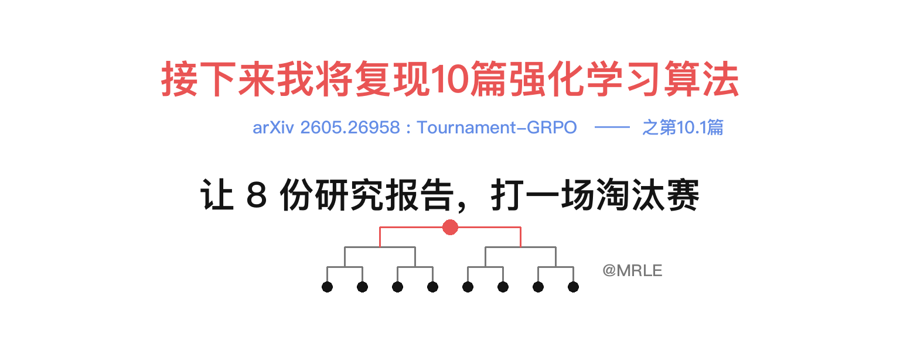
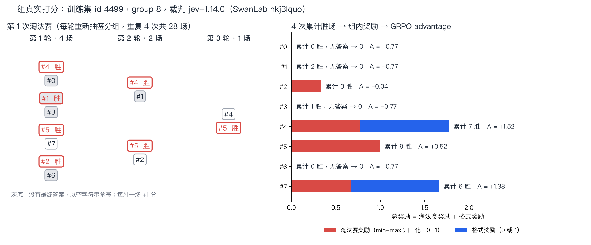
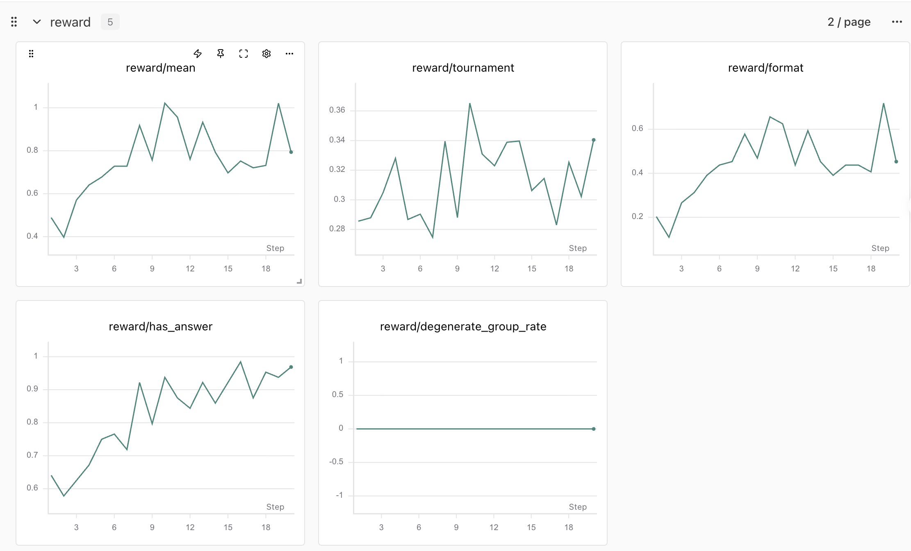
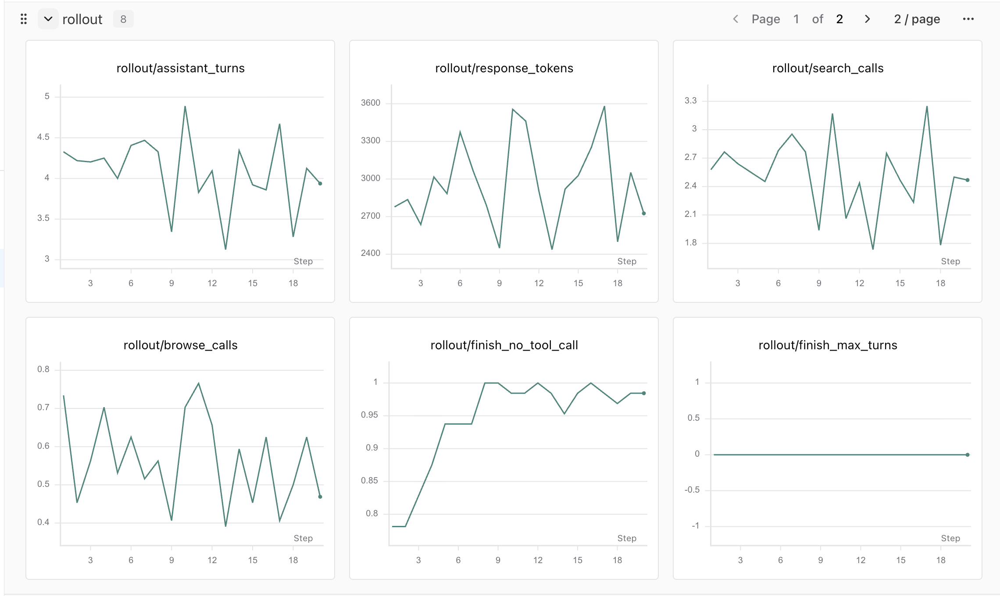
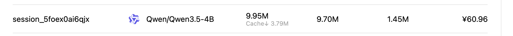

# 接下来我将复现 10 篇强化学习算法：第 10.1 篇，Tournament-GRPO：让 8 份研究报告打一场淘汰赛

> 想跳过正文直接运行？请查看 [快速启动指南](./start.md)：准备数据 → 配置工具与裁判 → 训练 → 评测。

<div align="center">
  
</div>

<div align="center">
  <a href="https://github.com/datawhalechina/agentic-rl-lab/tree/main/experiments/tournament-grpo"></a>
  <a href="https://arxiv.org/abs/2605.26958v2"></a>
  <a href="https://github.com/PuffYang/Tournament_GRPO/tree/eea826cf66705cac9ec81823f746d0ccd6074228"></a>
  <a href="https://docs.pytrio.com/docs"></a>
  <a href="https://swanlab.cn/@MRLE/tournament-grpo"></a>
</div>

> **代码与复现资源**
>
> - 本章实现：[训练](https://github.com/datawhalechina/agentic-rl-lab/blob/main/experiments/tournament-grpo/train.py) / [淘汰赛奖励](https://github.com/datawhalechina/agentic-rl-lab/blob/main/experiments/tournament-grpo/reward.py) / [多轮 rollout](https://github.com/datawhalechina/agentic-rl-lab/blob/main/experiments/tournament-grpo/rollout.py) / [裁判](https://github.com/datawhalechina/agentic-rl-lab/blob/main/experiments/tournament-grpo/judge.py)
> - 论文：[Tournament-GRPO: Group-Wise Tournament Rewards for Reinforcement Learning in Open-Ended Long-Form Generation(EMNLP'26)](https://arxiv.org/abs/2605.26958v2)
> - 作者代码：[PuffYang/Tournament_GRPO](https://github.com/PuffYang/Tournament_GRPO/tree/eea826cf66705cac9ec81823f746d0ccd6074228)
> - SwanLab：[20-step 训练记录](https://swanlab.cn/@MRLE/tournament-grpo/v1/x1tb4s/runs/s474uc49/chart)
> - 搜索与裁判：[DeepSeek Search API](https://api-docs.deepseek.com/zh-cn/guides/search/) / [Jina Reader](https://jina.ai/reader/) / [Jev](https://docs.typesafe.ai/api/system-one) `jev-1.14.0`
> - 本章作者：[MRLE](https://mrlepro.com)


前面的 [Search-R1](https://github.com/datawhalechina/agentic-rl-lab/blob/main/experiments/search-r1/readme.md) 和 [ReTool](https://github.com/datawhalechina/agentic-rl-lab/blob/main/experiments/retool/readme.md) 都有一个舒服的前提：答案能对上标准答案，reward 就是 1。这一篇换成 deep research 任务：模型自己搜索、读网页，最后写一份研究报告。比如训练集里的一道题是：

> What progress has been made in the application of data mining in materials science research?

这种题没有标准答案。两份报告可能都对，只是一份覆盖更全、证据更扎实。reward 只能交给 LLM 裁判，按这道题的 rubric 来评。

Tournament-GRPO 关心的是：裁判应该怎样给分，GRPO 才能拿到有用的信号。它的答案很朴素：别让裁判给每份报告单独算分，让同一道题的报告两两比赛，按胜场算 reward。

我把作者的 verl 实现搬到了 PyTRIO 上：Qwen3.5-4B LoRA，DeepSeek 搜索加 Jina 读网页，Jev 当裁判。下面先画一张地图，再讲算法、代码和实验。

## 0. 先看结论

| 项目 | 状态 |
| --- | --- |
| 淘汰赛奖励、格式奖励、advantage、PPO loss | 已对照作者函数逐项核验数值和梯度 |
| 20-step 训练（8 题 × 8 条轨迹） | 1,280 条轨迹、4,480 场裁判比较，答案完成率 64% → 97% |
| Base vs checkpoint 评测 | Deep Research Bench 全部 100 题，RACE Overall 20.65 → 34.70 |
| 费用与耗时 | 训练 78.92 元（4 小时 3 分钟）+ 评测 13.12 元，共 92.04 元 |

20 步之后，模型最明显的变化是学会了按时交卷。100 题评测里，答案完成率从 60% 升到 98%，格式合规率从 42% 升到 72%。RACE Overall 的 14 分涨幅主要来自白卷变少：空报告记 0 分，Base 有 40 题没交卷。只看两边都写出报告的 59 题，Overall 是 34.49 → 35.25。

## 1. 先画一张地图

Rubric-based RL 的训练闭环大致是这样：

```math
\text{Prompt} \rightarrow \text{Rubric} \rightarrow \text{Judge} \rightarrow \text{Reward} \rightarrow \text{GRPO} \rightarrow \text{Policy}
```

对一道题，先准备一组 rubric，也就是这道题的评分标准；policy 对同一道题采样多份回答；judge 结合问题、回答和 rubric 判分，汇总成每份回答的 reward；GRPO 用同题回答之间的相对 reward 计算 advantage，更新 policy，再进入下一轮采样。

Tournament-GRPO 在这张图上只动了 **Judge → Reward** 这一段：

| 节点 | Tournament-GRPO 的做法 |
| --- | --- |
| Rubric | 训练前用 GPT-4o 为每道题生成，训练中保持不变（静态 rubric） |
| Judge | 一次看 2 份回答和完整 rubric，选出更好的一份 |
| Reward | 多轮淘汰赛累计胜场，组内 min-max 归一化，再加 0/1 格式奖励 |
| GRPO / Policy | 标准 GRPO 组内标准化 advantage 和 PPO clip，没有改动 |

所以读这一篇时，可以把注意力放在一个问题上：**同样一个裁判，换一种问法，GRPO 拿到的信号会有什么不同？**

## 2. Tournament-GRPO 从哪里来，解决什么问题？

>Tournament-GRPO 是 Zixuan Yang 等人提出的工作，已被 **EMNLP 2026 主会（Main Conference）录用**。论文全名是 *Tournament-GRPO: Group-Wise Tournament Rewards for Reinforcement Learning in Open-Ended Long-Form Generation*。

论文把现有做法统称为 pointwise 打分。它的共同点是：裁判每次只看一份回答，看不到同组的其他回答。常见的形式有两类：

- **逐条判断**：把 rubric 拆成若干检查项，裁判逐条判断是否满足（0/1），再按权重求和、归一化成一个分数。RaR 这类方法属于这一类，论文里的 GRPO explicit、GDPO 基线也是逐条 rubric 打分。
- **整体打分**：裁判参照 rubric，直接给整份回答一个分数，比如 1–10 分。论文里的 implicit 基线属于这一类。

两类形式最后都给每份回答算出一个独立的分数，直接当 reward。作者认为这在长文本 RL 里有三个问题：

1. **分数尺度难校准**。整体打分要把一份很长的报告压成一个数；逐条判断虽然每项只问“满足没有”，但满足的门槛由裁判单独把握，权重和汇总方式又决定了最终尺度。不同题目、不同训练阶段的 0.7，不一定代表同样的质量。
2. **组内区分度弱**。同一道题的 8 份回答在很多检查项上结果相同：容易的项大家都满足，都记 1；难的项大家都没做到，都记 0。这些项没有组内差异，汇总后 reward 挤在一起，GRPO 的 advantage 主要剩下噪声。整体打分也类似，8 份回答常常集中在 7、8 分。
3. **容易饱和**。训练一段时间后，policy 学会满足容易拿分的检查项（结构、格式、覆盖面），这些项很快全是 1；更难的维度（证据使用、洞察）反而没拉开。

关键的观察在于 GRPO 本身：它只关心同一道题里谁比谁好，用不上一个全局校准的绝对分数。既然如此，不如直接让裁判做比较。

比较的思路来自 TourRank（用多轮组内比较做排序）。论文还设了一个 Pairwise 基线：8 份回答两两全部比一遍（28 场），用胜率当 reward，这个思路来自 ArenaRL。Tournament-GRPO 则是淘汰赛：两两分组，胜者晋级，再分组，直到剩下一个；整场重复几次，累计胜场。

## 3. 用人话解释：手冲咖啡店的新豆评测

假设一家手冲咖啡店新到了一款埃塞俄比亚豆子，8 位咖啡师各冲了一杯。店长手里有一张评测卡：花果香要清楚、酸质要明亮但不刺、甜感要干净、余韵不能发苦。

**pointwise 打分**是店长挨个尝，每杯单独算分。可以对着评测卡逐项打勾（花果香清楚吗？酸质刺不刺？），按权重加总；也可以直接打 1–10 分。两种方式都只看眼前这一杯。逐项打勾时，8 杯里好几杯可能每项都打了勾，总分一样；直接打分时，喝到第 6 杯，店长已经很难记清第 1 杯的花香算 7 分还是 8 分。

**淘汰赛**是店长每次只尝两杯，拿着评测卡判断哪杯更好。8 杯先抽签分成 4 组，胜者晋级；4 杯再分 2 组，最后决出 1 杯冠军。每赢一场记 1 分。为了减少抽签运气，整场比赛重新抽签再来 3 次。最后按累计胜场排名：

- 胜场最多的咖啡师拿 1 分，最少的拿 0 分，中间按比例分配；
- 如果所有人胜场一样，大家都拿 0.5 分；
- 有咖啡师没有端出咖啡（没写出最终答案），他也照样被排进比赛，但最后成绩直接记 0；
- 另外，按店里的冲煮流程完成记录（格式合规）的再加 1 分。

然后把这 8 杯咖啡的成绩放在一起比较：比平均好的冲法被鼓励，比平均差的冲法被压低。下一轮大家调整研磨度、水温和注水节奏，再冲、再比。

店长在这个过程中只回答一个问题：“这两杯哪杯更好？”这比“这杯值几分？”容易回答得多。

## 4. 核心变量和公式

| 符号 | 含义 | 本章取值 |
| --- | --- | --- |
| K | 每道题采样的回答数（GRPO 的 group） | 8 |
| G | 每场比赛的人数 | 2 |
| W | 每场晋级人数 | 1 |
| F | 剩下几人时这次淘汰赛结束 | 1 |
| M | 整场淘汰赛重复次数 | 4 |
| $s_i$ | 第 $i$ 份回答 M 次淘汰赛的累计胜场 | 0–12 |

K=8 时，一次淘汰赛有 4 + 2 + 1 = 7 场，重复 4 次共 28 场。累计胜场归一化成淘汰赛奖励：

```math
r_i^{\text{tour}} = \frac{s_i - \min_j s_j}{\max_j s_j - \min_j s_j}
```

所有 $s_i$ 相同时，$r_i^{\text{tour}} = 0.5$；没有最终答案的回答，归一化之后再置为 0。总奖励加上 0/1 的格式奖励，范围是 0–2：

```math
r_i = r_i^{\text{tour}} + r_i^{\text{fmt}}
```

advantage 按作者实现使用组内样本标准差（`ddof=1`）：

```math
A_i = \frac{r_i - \operatorname{mean}(r_{1..K})}{\operatorname{std}(r_{1..K}) + 10^{-6}}
```

下面是训练中真实的一组打分，题目就是开头那道材料科学题：



图里有几个值得看的细节：

- 第 1 次淘汰赛的决赛是 #4 对 #5，#5 赢了。4 次累计下来 #5 胜 9 场，#4 胜 7 场，所以 #5 的淘汰赛奖励是 1.0，#4 是 7/9 ≈ 0.78。
- #4 和 #7 格式合规，各加 1 分，总奖励反而超过了 #5。在这一组里，格式奖励对排序的影响比淘汰赛奖励还大。
- #1 没有答案，却赢了 2 场。它是在两份空答案之间被判胜的。归一化后它的奖励仍被置 0，但这 2 场比赛同样花了裁判调用。

## 5. 我们是怎么复现的？

### 5.1 训练闭环

`train.py` 每一步做这些事：

```text
1. 把最新权重交给 sampler。
2. 取 8 道题，每题采样 8 条多轮轨迹（rollout.py）。
3. 对每道题：格式检查 + 28 场淘汰赛，得到 8 个 reward（reward.py + judge.py）。
4. 组内标准化得到 advantage。
5. 用自定义 PPO loss 做一次 forward_backward，再做一次 AdamW。
```

一步共 64 条轨迹、224 场裁判比较，每批只更新一次。

### 5.2 数据

训练数据直接用作者仓库发布的 Parquet 文件：DR-Tulu 4,627 条、RaR-Science 2,793 条、RaR-Medicine 960 条，共 8,380 条训练题和 441 条验证题。每道题自带一组 rubric，每条 rubric 有 title、description、dimension 和 importance（critical / important 等）。

`prepare_data.py` 只做格式转换和筛长：按作者 verl 配置筛掉超过 4096 token 的 prompt，用 Qwen3.5-4B tokenizer 筛完剩 8,378 / 440 条。评测集是作者附带的 Deep Research Bench，100 道研究题，带评分 criteria 和参考报告。

### 5.3 Rollout：两个工具，一套 XML 协议

模型能用两个工具，名字和作者一致：`google_search` 返回搜索摘要，`browse_webpage` 读取网页正文。一条轨迹长这样（摘自上面那组的 #4，有删节）：

```text
<think>I need to research the progress made in data mining applications in materials science ...</think>
<call_tool name="google_search">data mining applications materials science research progress 2023 2024</call_tool>
<tool_output>
<snippet>Title: Recent progress on machine learning with limited materials data ... </snippet>
...
Environment notice: tool budget exhausted; no tool calls remain. ...
</tool_output>
<think>Based on all the evidence collected, ...</think>
<answer>Data mining has made significant progress in materials science research ...</answer>
```

`<tool_output>` 里的内容来自外部环境，它们留在上下文里，但 mask 为 0，不参与 loss。模型只为自己生成的 think、工具调用和 answer 负责。这部分做法和 Search-R1 一章相同。

为了降低复现成本，我把搜索从 Top 10 改成 Top 3，交互上限从 8 轮 / 7 次工具改成 6 轮 / 4 次工具。预算砍短之后，模型常常还按原来的节奏继续研究，在请求第 5 次工具时被截断，一个字的答案都没写。一组 8 条轨迹如果全是空答案，reward 和 advantage 全是 0，这一步就没有梯度。

所以我在第 4 次工具结果的末尾加了一段环境提示：工具预算已用尽，请根据已有证据直接写最终答案，证据不足就说明局限。模型知道该收尾了，组内才会出现有答案和没答案、写得好和写得差的差异。

这段提示属于环境内容，同样 mask 为 0。它是我相对作者新增的改动，会在差异表里披露。

### 5.4 Reward：淘汰赛本体

淘汰赛的核心代码在 `reward.py` 的 `run_tournament`，去掉日志后只有这么几行：

```python
scores = [0.0] * len(answers)
rng = random.Random(judge.seed)
for repeat in range(TOURNAMENT_REPEATS):           # M = 4
    candidates = list(range(len(answers)))
    while len(candidates) > 1:                       # F = 1
        rng.shuffle(candidates)
        num_groups = len(candidates) // PLAYERS_PER_MATCH   # G = 2
        groups = [candidates[i::num_groups] for i in range(num_groups)]
        winners = []
        for group in groups:
            local_index, _ = judge.judge(query, rubrics, [answers[i] for i in group])
            winner = group[local_index]              # W = 1
            scores[winner] += 1.0
            winners.append(winner)
        candidates = winners
```

裁判只看到问题、完整 rubric 和每份回答的最终 `<answer>`，看不到推理和搜索过程。作者的裁判提示词要求“恰好选一个胜者，优先准确、完整、有依据、直接回答问题的回答”。

格式奖励是 0 或 1，检查完整轨迹：开头要有非空 think，至少搜索一次，每次工具调用都要接 `tool_output` 和 think，最后恰好一个非空 answer，不能有标签外的杂文或损坏的 XML。规则照搬作者的 `tournament_grpo_reward.py`。

作者在裁判请求失败时会随机选一个胜者继续训练。我去掉了这个回退，失败三次就停止训练。原因来自一次真实事故：旧配置的 20-step 训练跑到第 15 步，裁判接口连续网络失败，224 场比赛里有 150 场退回了随机胜者，这一步的 reward 基本是随机数。用随机 reward 更新权重，比停下来修好接口再续训更糟。

### 5.5 Advantage 与 PPO loss

advantage 是第 4 节的组内标准化。loss 按作者的 vanilla PPO 写成 PyTRIO 自定义 loss（`train.py` 的 `ppo_objective`）：

```python
log_ratio = (current - old).clamp(-20.0, 20.0)
ratio = log_ratio.exp()
losses1 = -advantages * ratio
losses2 = -advantages * ratio.clamp(0.8, 1.2)          # clip 0.2
clipped = torch.maximum(losses1, losses2)
dual_bound = -advantages * 3.0                         # dual clip 3，只作用于负 advantage
losses = torch.where(advantages < 0, torch.minimum(dual_bound, clipped), clipped)
loss = losses.mean()                                   # 整个 batch 的 assistant token 取均值
```

没有 KL 项，也没有熵项。每批只更新一次，所以 old logprob 直接取训练端前向的 `current.detach()`。此时 ratio 恒为 1、clip 不会触发，但梯度仍然是 $-A \cdot \nabla \log \pi$，等价于作者的设置。如果以后改成同一批数据更新多次，就必须在第一次更新前把 old 固定下来。

### 5.6 与作者实现的差异

| 项目 | 作者 | 本章 | 影响 |
| --- | --- | --- | --- |
| Policy | Qwen2.5-7B-Instruct，全参数，lr 1e-6 | Qwen3.5-4B，LoRA rank 32，lr 4e-5 | 绝对分数不能和论文对比 |
| 裁判 | 自部署 Qwen2.5-72B-Instruct，chat 提示词 | Jev `jev-1.14.0`，提示词适配为 state + 单选 choice | 裁判偏好不同，见第 8 节 |
| 搜索 | 未写明供应商的搜索服务，Top 10 | DeepSeek Search API，Top 3；query 超过 128 字符截断 | 证据覆盖变少，结果随时间变化 |
| 浏览 | Jina Reader | Jina Reader；服务器上用官方国内域名 `r.jinaai.cn` | 访问地址不同，协议相同 |
| 交互预算 | 8 轮 / 7 次工具，用完直接停 | 6 轮 / 4 次工具，最后一次工具结果附收尾提示 | 研究深度变浅；新增环境提示 |
| 裁判失败 | 随机选胜者 | 停止训练，从 checkpoint 续训 | 不会用随机 reward 更新 |
| 训练规模 | batch 16，多 epoch，约 1,100–1,600 step | batch 8 题 × 8 条，20 step | 只能观察早期行为变化 |
| 实验追踪 | WandB | SwanLab | 无 |

淘汰赛结构（G=2、W=1、F=1、M=4）、归一化、无答案置 0、格式规则、18000 token 的 response 预算、3000 字符的工具截断和作者 prompt 都保持原样。

## 6. 实验结果

### 6.1 20-step 训练

配置：Qwen3.5-4B，LoRA rank 32，lr 4e-5，每步 8 题 × 8 条轨迹，共 20 步。完整记录见 [SwanLab](https://swanlab.cn/@MRLE/tournament-grpo/v1/x1tb4s/runs/s474uc49/chart)。



| 指标 | Step 1 | Step 10 | Step 20 |
| --- | ---: | ---: | ---: |
| 答案完成率 | 64.1% | 93.8% | 96.9% |
| 格式合规率 | 20.3% | 65.6% | 45.3% |
| 总 reward | 0.489 | 1.022 | 0.794 |
| 淘汰赛 reward | 0.286 | 0.365 | 0.340 |
| 每条轨迹搜索次数 | 2.58 | 3.17 | 2.47 |
| 每条轨迹浏览次数 | 0.73 | 0.70 | 0.47 |
| 每条轨迹 response tokens（含工具返回） | 2,778 | 3,556 | 2,725 |

答案完成率升得最稳：前 3 步均值 61.5%，后 3 步均值 95.3%。格式合规率升得慢，也更抖，前后 3 步均值从 19.3% 到 52.6%，第 10 步到过 65.6%，第 20 步又回到 45.3%。淘汰赛奖励只从 0.29 升到 0.32。`reward/degenerate_group_rate` 全程为 0，每一组都拿到了非零 advantage。



`rollout/finish_no_tool_call` 从 0.78 升到接近 1。前几步约 22% 的轨迹在请求第 5 次工具时被截断，第 8 步以后基本消失，模型学会了在收到预算提示后收尾。搜索次数、浏览次数和 response 长度在 20 步里上下波动，没有明显趋势。

### 6.2 Eval

评测用作者附带的 Deep Research Bench 全部 100 题。Base 和 Step 20 工具配置相同，每题贪心生成 1 条轨迹（seed 42，Top 3 搜索，最多 4 次工具调用）。

打分用 RACE：裁判按每道题的 criteria，把待评报告和作者的参考报告逐条比较、各打 0–10 分后加权，最终分数是待评报告占两者之和的比例，50 分相当于和参考报告打平。裁判是 `deepseek-flash`（关闭思考），论文用的是 Qwen2.5-72B-Instruct。

| RACE（0–100） | Base | Step 20 | 差值 |
| --- | ---: | ---: | ---: |
| 全面性 Comprehensiveness | 19.21 | 32.33 | +13.12 |
| 洞察力 Insight | 17.11 | 29.67 | +12.56 |
| 指令遵循 Instruction Following | 24.95 | 40.77 | +15.82 |
| 可读性 Readability | 23.91 | 40.01 | +16.10 |
| **Overall** | **20.65** | **34.70** | **+14.05** |

| 生成指标 | Base | Step 20 |
| --- | ---: | ---: |
| 答案完成 | 60/100 | 98/100 |
| 格式合规 | 42/100 | 72/100 |
| 每题工具调用 | 3.98 | 3.94 |
| 每题模型生成 tokens | 826 | 1,641 |

涨幅主要来自白卷变少。Base 有 40 题用完工具次数也没写出报告，这些题记 0 分；Step 20 只有 2 题。两边都写出报告的 59 题上，Overall 只从 34.49 到 35.25，单份报告的水平接近。生成 token 翻倍也是同一个原因：Base 的白卷平均只有 220 个 token。

SwanLab：[Base 生成](https://swanlab.cn/@MRLE/tournament-grpo/runs/5cqbugvp)、[Step 20 生成](https://swanlab.cn/@MRLE/tournament-grpo/runs/0fw66y62)、[Base RACE](https://swanlab.cn/@MRLE/tournament-grpo/runs/5lz7d3t0)、[Step 20 RACE](https://swanlab.cn/@MRLE/tournament-grpo/runs/7gyzdjge)。

### 6.3 成本

| 阶段 | 项目 | 花费（元） |
| --- | --- | ---: |
| 训练 | PyTRIO（训练与采样） | 60.96 |
| 训练 | DeepSeek Search | 16.96 |
| 训练 | Jev 裁判 | 1.00 |
| 评测 | PyTRIO（采样） | 3.20 |
| 评测 | DeepSeek | 9.92 |
| | **合计** | **92.04** |

PyTRIO 账单：



训练总时长 4 小时 3 分钟，平均每步 12.2 分钟，每步约 3.95 元。时间大头在裁判：4,480 场比较累计约 2 小时 22 分钟，占 58%，费用却只有 1 元。20 步里裁判共读入约 758 万 token、输出约 13.9 万 token，模型共搜索 3,218 次、浏览网页 722 次。评测时生成 100 份报告，Base 用了 4.5 分钟，Step 20 用了 13.2 分钟。

## 7. 训练时最应该看哪些指标？

淘汰赛奖励是组内的相对位置，不是绝对质量，所以 reward 曲线不能当收敛指标，模型好坏要看独立评测。训练中主要看这几组指标：

| 指标 | 看什么 |
| --- | --- |
| `reward/has_answer`、`reward/format` | 答案完成率和格式合规率 |
| `reward/tournament` | 淘汰赛奖励均值；无答案记 0，所以会随答案率上升 |
| `reward/degenerate_group_rate` | 8 个 reward 完全相同、没有梯度的题占比 |
| `rollout/finish_*` | 轨迹是正常结束，还是被轮数、工具次数或长度截断 |
| `rollout/search_calls`、`rollout/browse_calls`、`rollout/response_tokens` | 工具用量和轨迹长度 |
| `tools/error_rate` | 搜索和浏览是否稳定，环境出错会直接污染 reward |
| `judge/input_tokens` | 裁判 token 用量，直接对应费用 |

想检查裁判，就从 `judge.jsonl` 抽样，里面有每场比赛的候选、胜者和裁判原始输出。

## 8. 这次复现有哪些边界？

- policy、裁判、搜索后端和训练规模都和论文不同，分数不能和论文直接对比。本章验证的是淘汰赛奖励接到 PyTRIO 上后，训练链路是否正确、早期行为往哪变。

## 9. Insight and Action

下面是复现中注意到、还没验证的事。

- **二人组重复 4 次并不省裁判调用。** K=8 时 4 × 7 = 28 场，和两两全比的 C(8,2) 一样多，区别只在 reward 怎么分配。论文里省调用的是重复 2–3 次的配置。Action：用同一批轨迹离线跑 M=2 和 M=4，比较 advantage 排序。

- **早期 reward 上涨主要来自格式奖励。** 前 3 步到后 3 步，总 reward 0.485 → 0.849，约 92% 的增量来自格式奖励（0.193 → 0.526），淘汰赛奖励只从 0.293 到 0.323。Action：分开看 has_answer、format、tournament，答案率稳定后再看淘汰赛奖励的组内方差。

## 10. 小结

Tournament-GRPO 的改动很小，只换了 reward 的来源：

```text
1. 每道题采样 8 份带工具调用的研究报告。
2. 两两比赛、胜者晋级，整场重复 4 次，累计胜场。
3. 组内 min-max 归一化，无答案记 0，再加 0/1 格式奖励。
4. 组内标准化得到 advantage，用 vanilla PPO 更新。
```

它背后的判断是：GRPO 只需要知道同组里谁更好，那就直接问裁判谁更好。这个思路在没有标准答案的长文本任务里很自然，代价是裁判调用随 M 线性增长，而且奖励质量完全取决于裁判。

复现过程中，花时间最多的是环境：砍掉工具预算后模型不会收尾，裁判网络失败会产生随机 reward，搜索接口对 query 长度有限制。这些和算法本身无关，却决定了一步训练有没有有效梯度。Agentic RL 里，环境质量本身就是实验变量。

这次 20 步训练花了 78.92 元、4 小时 3 分钟，评测再花 13.12 元，合计 92.04 元。在 Deep Research Bench 全部 100 题上，答案完成率 60% → 98%，格式合规率 42% → 72%，RACE Overall 20.65 → 34.70。

## 参考资料

1. Zixuan Yang et al. [Tournament-GRPO: Group-Wise Tournament Rewards for Reinforcement Learning in Open-Ended Long-Form Generation](https://arxiv.org/abs/2605.26958v2), EMNLP 2026.
2. [PuffYang/Tournament_GRPO@eea826cf](https://github.com/PuffYang/Tournament_GRPO/tree/eea826cf66705cac9ec81823f746d0ccd6074228)：作者代码、训练数据与 Deep Research Bench
3. [Qwen/Qwen3.5-4B](https://huggingface.co/Qwen/Qwen3.5-4B)
4. [DeepSeek Search API](https://api-docs.deepseek.com/zh-cn/guides/search/)
5. [Jina Reader](https://jina.ai/reader/)
6. [PyTrio-Jev 章节](https://github.com/datawhalechina/agentic-rl-lab/blob/main/experiments/pytrio-jev/readme.md)
7. [Tournament-GRPO PyTRIO 完整代码](https://github.com/datawhalechina/agentic-rl-lab/tree/main/experiments/tournament-grpo)
8. [PyTRIO 文档](https://docs.pytrio.com/docs) / [自定义 loss](https://docs.pytrio.com/docs/guide/custom_loss)
9. [SwanLab 文档](https://docs.swanlab.cn/)
